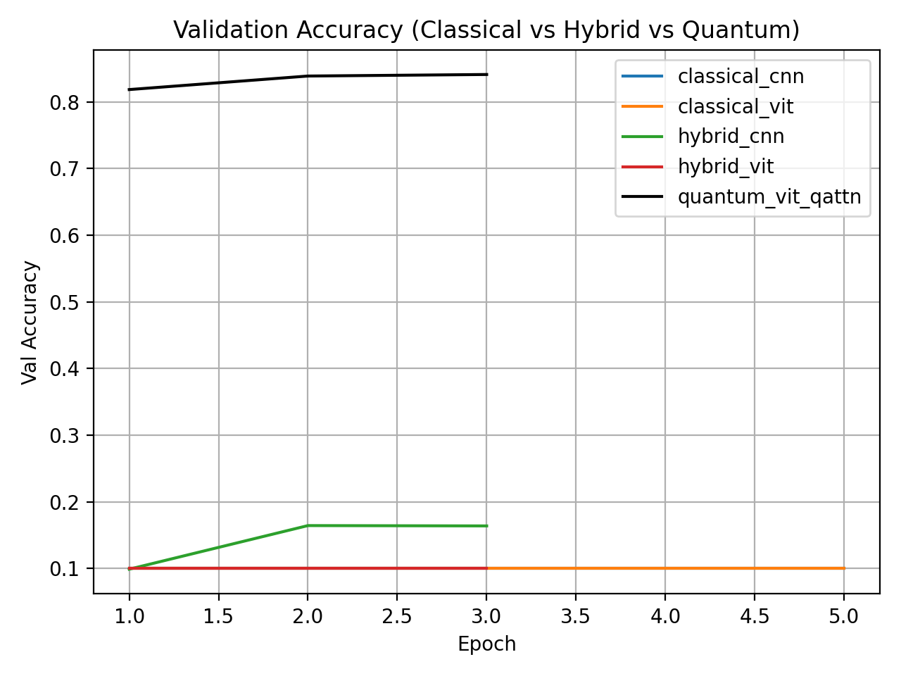

# Hybrid Quantum-Classical Vision Models (CUDA-Q)

**Georgia Tech CS 7643 — Deep Learning final project**

A research-style comparison of classical CNN / ViT baselines, hybrid variational quantum circuit (VQC) models, and a quantum-attention vision transformer on Fashion-MNIST. The project combines PyTorch with NVIDIA CUDA-Q simulation.

> **Important evaluation caveat:** The original training scripts call Fashion-MNIST's official `test` split the "validation" loader and evaluate it during model selection. Therefore reported "validation accuracy" is **not an unbiased held-out test estimate**. This repo preserves the historical results; a separate validation split and final untouched test evaluation are needed before making generalization claims. The near-random classical baseline results also require investigation before any claim of quantum advantage.

## Results from the committed experiment logs

These are historical values read from `results/*.csv`, not newly rerun benchmarks.

| Experiment | Best reported accuracy | Epochs logged |
| --- | ---: | ---: |
| Classical CNN | 10.0% | 5 |
| Classical ViT | 10.0% | 5 |
| Hybrid CNN + VQC | 16.4% | 3 |
| Hybrid ViT + VQC | 10.0% | 3 |
| Quantum-ViT (quantum attention) | **84.1%** | 3 |

The 84.1% figure is the best accuracy in `results/quantum_vit_qattn.csv` under the **original experimental protocol**. These results do **not** demonstrate superiority over a properly tuned classical ViT. The model comparisons need controlled training budgets, seeds, and a held-out test set.



## Repository guide

| Path | Contents |
| --- | --- |
| `src/models.py`, `src/quantum_attention.py`, `src/quantum_head.py` | Classical and quantum-hybrid model implementations |
| `src/train_classical.py`, `src/train_hybrid.py`, `src/train_quantum_transformer.py` | Training entrypoints |
| `src/experiments/run_experiments.py` | Classical and hybrid experiment runner |
| `src/experiments/plot_results.py` | Visualization of logged metrics |
| `run_all_experiments.ipynb` | Notebook experimentation |
| `results/*.csv`, `results/*_config.json` | Original per-epoch metrics and configurations |
| `logs/`, `checkpoints/`, `figures/` | Original logs, checkpoints, and visualizations |
| `CS7643_project_report.pdf` | Original course project report |

The dataset is included under `data/FashionMNIST/` in the current repository. In future revisions it should be downloaded on demand rather than committed as large files. Python `__pycache__` artifacts are also already tracked; `.gitignore` prevents new files but does not delete historical objects.

## Environment

An NVIDIA-compatible setup with PyTorch and CUDA-Q is needed for the quantum models. CUDA-Q and PyTorch versions, GPU architecture, and platform affect reproducibility. The environment file provides a starting point, **not a locked environment**.

```bash
conda env create -f environment.yml
conda activate cs7643_project
python -c "import torch, cudaq; print(torch.__version__, cudaq.__version__)"
```

### Run from the expected working directory

The training scripts use local imports and relative data/output paths. Run them **from `src/`**:

```bash
cd src
python train_quantum_transformer.py --epochs 3 --batch_size 32
```

By default, the script writes logs/results/checkpoints to `../logs`, `../results`, and `../checkpoints`. For classical / hybrid experiments, review `src/experiments/run_experiments.py` and the notebook before starting any potentially long GPU workloads. The original artifacts are already provided, so rerunning is optional.

### Run lightweight repository checks (no GPU required)

```bash
python scripts/check_artifacts.py
python -m compileall -q src
```

CI checks source syntax and the structure of recorded result files. It does **not** train models, run CUDA-Q on hardware, reproduce accuracy, or validate scientific conclusions.

## Evaluation improvements needed

1. Split the original 60,000 Fashion-MNIST training examples into training and validation subsets. Hold the official 10,000-example test split untouched until model selection is complete.
2. Debug classical baselines that stay around 10% before drawing conclusions from hybrid variants.
3. Use identical splits, comparable training budgets, seeds, data transforms, and model size reporting.
4. Repeat independent runs with confidence intervals and report compute cost and elapsed time.
5. Provide a fresh final test result and full environment metadata.

## Citation and inspiration

- [NVIDIA CUDA-Q Quantum Transformer tutorial](https://nvidia.github.io/cuda-quantum/latest/applications/python/quantum_transformer.html)
- [Fashion-MNIST](https://github.com/zalandoresearch/fashion-mnist)
- See the original `CS7643_project_report.pdf` for course-context details.
